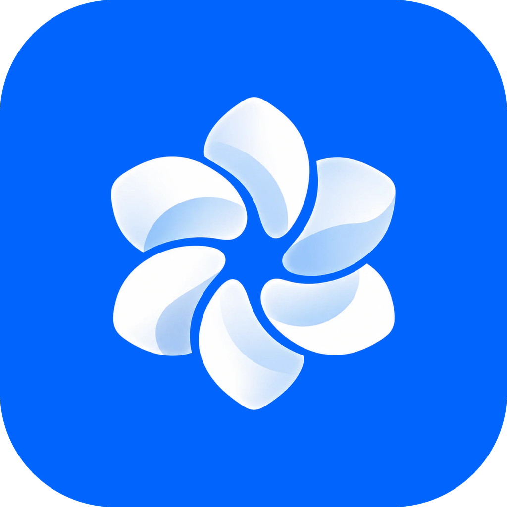

<p align="center">
  
</p>

<h1 align="center">Rodex</h1>

<p align="center">The AI copilot for Roblox Studio. Describe what you want, and it scripts, builds, models in Blender, makes shop icons and effects, and playtests in your place.</p>

<p align="center">
  <a href="https://rodexai.dev/download"></a>
</p>

<p align="center">
  
  
  <a href="https://rodexai.dev"></a>
</p>

---

## Download

| Platform | Download |
|---|---|
| Windows 10 / 11 (64-bit) | [Rodex-Setup.exe](https://github.com/imqlx/rodex-releases/releases/download/setup/Rodex-Setup.exe) · Installer (.exe) · 104 MB |
| macOS 12+ · Apple Silicon (M1 and newer) | [Rodex-mac-arm64.dmg](https://github.com/imqlx/rodex-releases/releases/download/setup/Rodex-mac-arm64.dmg) · Disk image (.dmg) · 117 MB |
| macOS 12+ · Intel | [Rodex-mac-x64.dmg](https://github.com/imqlx/rodex-releases/releases/download/setup/Rodex-mac-x64.dmg) · Disk image (.dmg) · 122 MB |
| Linux x64 | [Rodex-linux-x86_64.AppImage](https://github.com/imqlx/rodex-releases/releases/download/setup/Rodex-linux-x86_64.AppImage) · AppImage (any distro) · 124 MB |
| Linux x64 | [Rodex-linux-amd64.deb](https://github.com/imqlx/rodex-releases/releases/download/setup/Rodex-linux-amd64.deb) · Debian / Ubuntu (.deb) · 97 MB |

These links always give the newest version. By downloading you agree to the [Terms](https://rodexai.dev/terms) and [Privacy Policy](https://rodexai.dev/privacy).

## Install

### Windows
1. Run **Rodex-Setup.exe**. Windows may say *"Windows protected your PC"*, because the installer isn't code-signed yet. Click **More info**, then **Run anyway**.
2. Rodex installs and opens by itself.

### macOS
**Quickest:** open Terminal and paste

```bash
curl -fsSL https://rodexai.dev/install-mac.sh | bash
```

It picks the build for your Mac, checks it against the release's checksum and puts Rodex in Applications, with no security prompt.

**Or with the .dmg:**
1. Open the **.dmg** for your Mac (Apple Silicon for M1 and newer, Intel for older Macs) and drag **Rodex** into **Applications**.
2. Open Rodex from Applications. The first time, macOS says it can't check Rodex for malware, because it isn't notarized yet: click **Done**, open **System Settings → Privacy & Security**, scroll down and click **Open Anyway** next to Rodex.

When Rodex asks to see Studio's window (for playtest screenshots), allow it under **Screen Recording**.

### Linux
Roblox Studio has no Linux version; Rodex works with Studio running through [Vinegar](https://vinegarhq.org).
- **AppImage:** make it executable (`chmod +x Rodex-linux-x86_64.AppImage`) and run it.
- **Debian / Ubuntu:** `sudo apt install ./Rodex-linux-amd64.deb` (best on Ubuntu 24.04 and newer, whose AppArmor rules stop AppImages' sandbox).

Then the setup guide installs the Studio plugin and connects your AI (Claude Code, Codex, Cursor or a local model). You start with 300 free credits a month.

## Updates

You never download Rodex again. When there's a new version, Rodex shows **Update ready**. Click **Restart now** and you're on it; your chats and settings stay. To check by hand: **Help → Check for updates**.

Every update is signed. Rodex refuses anything that isn't signed with its key or doesn't match the published checksum.

## What you need

- Windows 10 or 11, macOS 12 or newer, or a 64-bit Linux desktop
- Roblox Studio (on Linux through Vinegar)
- A Claude, ChatGPT or Cursor plan, or a free local model with Ollama (Rodex walks you through it)

## Plans

Free to start with 300 credits a month. Monthly plans (Starter, Pro, Max) are on [rodexai.dev](https://rodexai.dev/#pricing).

## Help

- In the app: **Help → Report a problem** saves a report with your personal details taken out, for you to send.
- Email: contact@rodexai.dev
- Website and FAQ: [rodexai.dev](https://rodexai.dev)

## Which file do I download?

Only the one for your computer, from the table above. The other files on the [Releases](https://github.com/imqlx/rodex-releases/releases) page (`.update`, `latest.json`, `.lock.json`) are what Rodex downloads by itself when it updates.

## What's new (current version: 1.0.1)

**1.0.1** · Oct 23, 2026
- New Mobile Buttons add-on: touch buttons that look and sit like Roblox's jump button
- Analytics and Thumbnails pages are hidden for now while we improve them

**1.0.0** · Oct 22, 2026
- Rodex 1.0 is out for everyone
- New: macOS (Apple Silicon and Intel) and Linux (AppImage and .deb)
- Mac menu bar, Dock and Keychain support
- Updates install on every platform
- Downloads for every computer at rodexai.dev/download

**0.3.4** · Oct 22, 2026
- Sub-agents are off by default (start a message with /team to use them)
- New Save usage mode in Settings → Agent for small AI plans like Claude Pro
- Leaner prompt that uses less of your AI plan

**0.3.3** · Oct 22, 2026
- Playtests keep the place name instead of 'Game'

**0.3.2** · Oct 21, 2026
- Sound Lab: Rodex finds, checks and adds sound effects to your game
- Badges: Rodex makes badges with icons, and paid ones always ask first

**0.3.1** · Oct 21, 2026
- Big chats open instantly
- older messages load as you scroll up
- Long replies fold their earlier steps behind one row
- Errors now come with the button that fixes them
- A bad update rolls itself back
- Settings and chats keep backups, and chats can be exported

[All versions](https://github.com/imqlx/rodex-releases/releases)
